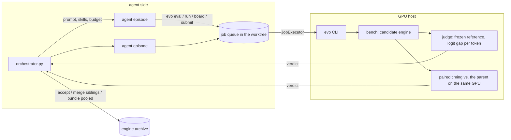

<p align="center">
  
</p>

# EvoInfer

**Agentic self-evolution of LLM inference systems.** EvoInfer lets coding agents (Codex, Claude Code, DeepSeek Harness) keep improving an
LLM inference engine on their own: agents propose changes, a trustworthy fitness function decides which ones survive,
accepted versions become the starting point of the next generation, and the knowledge the agents work from evolves
with them.

[中文说明](README_zh.md)

On Qwen3.5-35B-A3B (hybrid Gated DeltaNet + gated attention, 256-expert MoE, MTP speculative decoding) on one A100,
about 20 agent-hours took a naive port of the model into [nano-vllm](https://github.com/GeeeekExplorer/nano-vllm) from
**17.0 to 297.5 decode tok/s**, with end-to-end throughput **1.73-1.85x that of vLLM's default configuration**. Every
version is checked token by token against a frozen reference implementation.

| | Result |
|---|---|
| Main line (20 agent-hours, Codex) | decode 17.0 → 297.5 tok/s (17.5x); end-to-end 1.73x / 1.85x default vLLM; 7 of 15 versions came from recombination |
| Long-context lineage (8K-31K prompts) | the general engine's lead over default vLLM drops to 1.02x; two generations (34 changed lines) restore it to 1.60x |
| Edge lineage (32 GB GPU, 4-bit experts) | 1.61x / 1.79x default vLLM on the same weights |
| Same harness, other policy models (3 rounds × 2 agents) | Codex 6.77x (mean of 3 runs), Qwen3.8-Max 6.43x, GLM-5.3 4.31x, DeepSeek-V4-Pro 1.52x |
| Other target models, other seed engine | OLMoE-1B-7B 2.24x, Gemma 4 26B-A4B 9.12x, mini-sglang seed 1.82x |

The evolved engines ship in [`engines/`](engines/) and can be benchmarked directly (`orchestrator.py eval`).

## How it works



- **Individual level.** An *episode* is one agent improving the current best engine within a budget (e.g. 75 minutes
  and 8 evaluations), steered by a focus (`overhead`, `moe`, `spec`, `free`, ...). The agent can only reach the GPU
  through the `evo` command: `evo eval`, `evo run -- <cmd>`, `evo history`, `evo board`, `evo claim`, `evo submit`.
- **Fitness.** Correctness is judged on the candidate's *own* outputs: for every generated token, the logit gap between
  the reference's top choice and the emitted token, given the same prefix. Near-ties from legitimate floating-point
  reordering pass; real errors do not. Speed is measured *paired*: the parent is re-timed on the same GPU right before
  the candidate, and the decision needs a gain on both the dev set and a holdout set the agent never sees.
- **Population level.** Episodes run in parallel; accepted siblings are merged at the end of a round (by git, or by a
  merge agent on conflicts), correct changes below the noise threshold are pooled and evaluated as bundles, and a shared
  board keeps agents from working on the same functions.
- **Meta level.** A meta-agent rewrites the agents' skills (`skills/`) from the recorded evidence; it can never touch
  the fitness function.
- **Scenarios.** Lineages evolve for one deployment scenario each (long context, edge device, another model).

Details: [docs/architecture.md](docs/architecture.md).

## Quick start

Requirements:

- **GPU host:** Linux with an 80 GB GPU (A100/H100) for Qwen3.5-35B-A3B in BF16, CUDA 13 and Python 3.12.
- **Agent side:** Python ≥ 3.11, git, rsync, and one agent CLI: the [Codex CLI](https://github.com/openai/codex) or
  [Claude Code](https://docs.anthropic.com/en/docs/claude-code), logged in, or DeepSeek Harness
  (`npm i -g @deepseek-ai/dsh`, Node ≥ 24.9) with `DEEPSEEK_API_KEY` set.

The agent side and the GPU host can be one machine (default) or two machines connected over SSH.

```bash
git clone <this repo> evoinfer && cd evoinfer
bash scripts/setup_gpu_host.sh                # Python env for evaluations at ~/.evoinfer/venv
cp evoinfer.example.toml evoinfer.toml        # set [models] qwen3_5 and [gpus] pool
python3 orchestrator.py doctor                # checks everything and says how to fix what is missing
python3 orchestrator.py setup                 # engine archive, judge engine, prompt sets
```

Look at a result of the paper before evolving anything:

```bash
python3 orchestrator.py eval engines/evo-015 --gpu 0      # full benchmark + judge, ~10 min
```

Evolve the naive seed yourself:

```bash
python3 orchestrator.py init --scenario base --from baseline --gpu 0   # evaluate the seed: the main line's root
python3 orchestrator.py evolve --rounds 3 --gpus 0,1                    # per round: one agent per GPU, then integrate
python3 orchestrator.py status                                          # best version and every experiment
```

`evolve` uses Codex by default (`--agent claude` for Claude Code, `--agent dsh` for DeepSeek Harness, `--policy <name>`
for a policy from the config). One
round of two 75-minute episodes plus integration takes about 1.5-2 hours. An episode reads 3-5 M input tokens, mostly
cached. Every agent transcript is kept under `runs/<episode>/`; every evaluation, verdict and archive is kept under the
EvoInfer home on the GPU host (`~/.evoinfer/records`).

## Repository layout

| Path | What it is |
|---|---|
| `orchestrator.py` | episodes, final evaluation and verdicts, integration (merge, bundle), lineages, `doctor` / `setup` / `evolve` / `eval` |
| `meta.py` | the meta-agent that evolves the skills |
| `bin/evo` | what agents call; hands each call to the orchestrator through a queue in the worktree |
| `framework/evo/` | runs on the GPU host: `evo` CLI, evaluator, benchmark runner, judges, scenarios, coordination board |
| `skills/v0/` | the hand-written skills the agents read (the paper's starting knowledge) |
| `engines/` | the seed engine and the evolved engines from the paper |
| `data/` | prompt sets: `workloads/` (dev, visible to agents) and `holdout/` (acceptance only) |
| `experiments/` | scripts for the paper's experiments, including the no-harness baselines |
| `tests/` | unit and plumbing tests; no GPU needed (`python3 -m pytest tests`) |

## Documentation

- [docs/architecture.md](docs/architecture.md): episodes, the fitness function, verdicts, the population and meta
  levels, and where the state lives.
- [docs/configuration.md](docs/configuration.md): every config key, the local and SSH setups, policies and gateways,
  and shared GPUs.
- [docs/extending.md](docs/extending.md): new scenarios, target models, seed engines and focus areas.
- [experiments/README.md](experiments/README.md): reproducing the paper.

## Safety notes

Agents run their own code on your GPUs. EvoInfer limits what they can reach:

- Codex and DeepSeek Harness run in their `workspace-write` sandboxes, and Claude Code with a tool allow-list.
- DeepSeek Harness never holds an API key: it talks to a loopback forwarder in the orchestrator that adds the key.
- The evaluator, the judge and the holdout prompts live outside the agent's worktree.
- Agents never get SSH access or API keys for the GPU host.

Still, run EvoInfer on machines and accounts where that is acceptable, and read the transcripts.

## Citation

```bibtex
@misc{evoinfer2026,
  title  = {EvoInfer: Agentic Self-Evolution of LLM Inference Systems},
  author = {The EvoInfer authors},
  year   = {2026}
}
```

## License

MIT; see [LICENSE](LICENSE). The engines in `engines/` derive from nano-vllm (MIT) and keep its license file.
